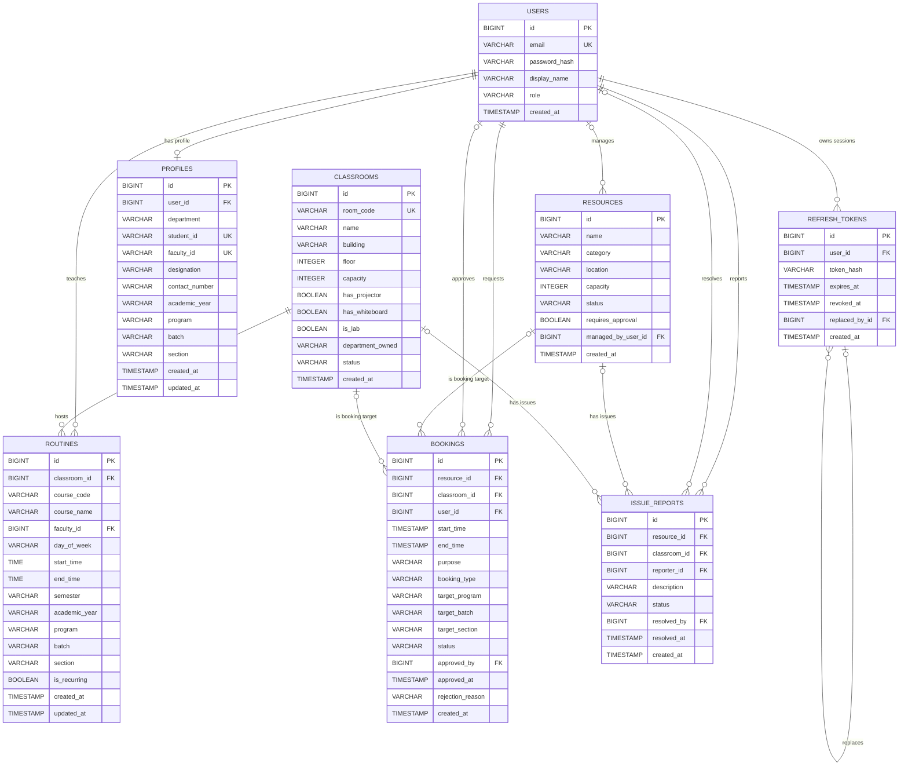
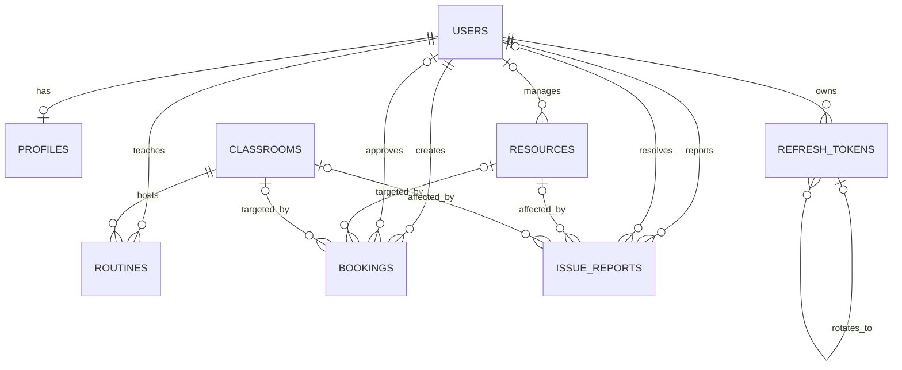

# OmniSpace Entity-Relationship Diagram

This ERD is derived from the Flyway migrations currently applied by the
OmniSpace backend:

- `V1__init_schema.sql`
- `V2__personal_schedule_and_slots.sql`
- `V3__add_cohort_batch.sql`

## Complete database ERD



## Compact presentation ERD

Use this version when the complete diagram is too dense for a presentation
slide.



## Relationship summary

| Parent           | Child                       | Relationship                                                        |
| ---------------- | --------------------------- | ------------------------------------------------------------------- |
| `users`          | `profiles`                  | One user has zero or one profile; every profile belongs to one user |
| `users`          | `refresh_tokens`            | One user can have many refresh-token records                        |
| `refresh_tokens` | `refresh_tokens`            | A refresh token may reference its replacement token                 |
| `users`          | `resources`                 | One user may manage many resources; a resource manager is optional  |
| `users`          | `routines`                  | One Faculty user can teach many routines                            |
| `classrooms`     | `routines`                  | One classroom can host many routines                                |
| `users`          | `bookings`                  | One user can create many bookings                                   |
| `users`          | `bookings.approved_by`      | One approver can approve many bookings; approval is optional        |
| `resources`      | `bookings`                  | A resource can have many bookings                                   |
| `classrooms`     | `bookings`                  | A classroom can have many bookings                                  |
| `users`          | `issue_reports`             | One user can report many issues                                     |
| `users`          | `issue_reports.resolved_by` | One user can resolve many issues; resolver is optional              |
| `resources`      | `issue_reports`             | A resource can have many issue reports                              |
| `classrooms`     | `issue_reports`             | A classroom can have many issue reports                             |

## Important schema constraints

### Booking target

Every booking must target exactly one asset type:

```text
Resource booking:  resource_id is set AND classroom_id is null
Classroom booking: classroom_id is set AND resource_id is null
```

This is enforced by the `chk_booking_target` database constraint.

### Issue target

Every issue report must target exactly one asset type:

```text
Resource issue:  resource_id is set AND classroom_id is null
Classroom issue: classroom_id is set AND resource_id is null
```

This is enforced by the `chk_issue_target` database constraint.

### Cohort matching

Profiles and routines store cohort information as separate text fields:

```text
program + batch + section
```

Targeted classroom bookings store the corresponding snapshot as:

```text
target_program + target_batch + target_section
```

These are currently matching fields rather than foreign keys to a separate
cohort table.

### Time validity

- `routines.start_time` must be earlier than `routines.end_time`.
- `bookings.start_time` must be earlier than `bookings.end_time`.
- Additional overlap and fixed-slot rules are enforced in the service layer.

### Cascading deletion

- Deleting a user cascades to that user's profile and refresh tokens.
- Deleting a classroom cascades to its routines.
- Other relationships use the database's default restrictive behavior unless
  explicitly handled by application logic.

## Key indexes

- Refresh-token lookup by user and token hash
- Routine lookup by classroom and weekday
- Routine cohort lookup by program, batch, section, academic year, and semester
- Booking overlap lookup by resource/classroom and time window
- Booking lookup by user and status
- Targeted booking lookup by program, batch, section, and status
- Issue lookup by resource/classroom and status
